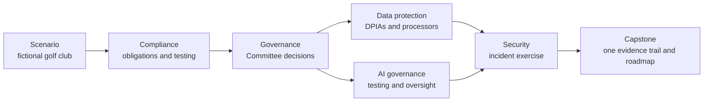

# AI Governance Portfolio: Abel Holla

Practical work in governance, risk and compliance, data protection, AI governance and security, by Abel Holla. Six connected projects follow one fictional Kenyan members' golf club from informal compliance to an integrated, tested management system.

> **Portfolio projects.** The projects in this repository use one fictional Kenyan golf club and illustrative data. They are not audits, legal opinions, or certifications.

## Start here

Read the [executive report](integrated-grc-capstone/07-executive/executive-report.md) of the capstone project: it summarises all six projects on one page and links to the evidence.

## Who this is for

Recruiters and hiring managers for roles in compliance, governance, risk, data protection, AI governance and security; and practitioners who want worked examples of registers, assessments and reports built on Kenyan law and international frameworks.

## Case study organisation

All projects are set in Kijani Heights Golf and Country Club, a fictional members' golf club in Kenya, so the evidence connects across compliance, governance and security. See the [organisation profile](scenario/organisation-profile.md).

## Projects

Built in six stages, in the order below.

| Project | Stage | What it shows | Folder |
|---|---|---|---|
| Compliance Management System | 1 and 2 | Obligations register, control testing, findings and corrective actions | [compliance-management-system](compliance-management-system/) |
| Enterprise Governance and Risk Dashboard | 3 | Delegation of authority, risk appetite, Committee decisions tracked to closure | [enterprise-governance-risk-dashboard](enterprise-governance-risk-dashboard/) |
| Data Protection and Privacy Assurance | 4 | Data inventory, DPIAs, processors, retention, rights and breach response | [data-protection-privacy-assurance](data-protection-privacy-assurance/) |
| AI Governance Framework | 4 | AI inventory, risk tiers, chatbot impact assessment and testing, oversight | [ai-governance-framework](ai-governance-framework/) |
| Security Risk and Incident Management | 5 | Security risk, access review, incident response, tabletop exercise, continuity | [security-risk-incident-management](security-risk-incident-management/) |
| Integrated GRC and Security Management System | 6 | One incident traced across all functions, one remediation roadmap | [integrated-grc-capstone](integrated-grc-capstone/) |

## How the projects connect

## How to navigate

Each project folder has a README with the problem, approach, deliverables, testing, recommendations and limitations, plus a standard set of documents: project charter, version history, assumptions register, methodology, evidence index, findings, corrective actions, KPIs, executive summary and limitations statement. CSV files open as tables on GitHub. Diagrams are written in Mermaid and render directly on GitHub.

## Frameworks used

Kenya's Data Protection Act 2019 and Bribery Act 2016; ISO 37301, ISO 37000, ISO 31000, ISO/IEC 42001, ISO 22301; NIST AI RMF 1.0 and NIST Cybersecurity Framework 2.0. Frameworks are used as structure; no certification is claimed.

## Website

The Notion portfolio link will be added here once the site is published.

## Licence

The content of this repository is licensed under [Creative Commons Attribution 4.0 International (CC BY 4.0)](LICENSE). You may share and adapt it, with credit to Abel Holla.

## Contact

Email: [hollaabel23@gmail.com](mailto:hollaabel23@gmail.com)

LinkedIn: [Abel Holla](https://www.linkedin.com/in/abel-holla-699905a0/)
