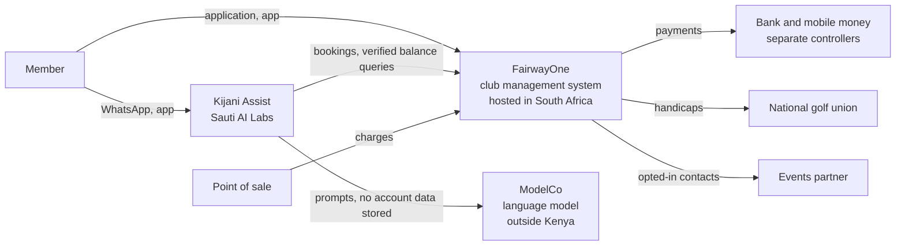
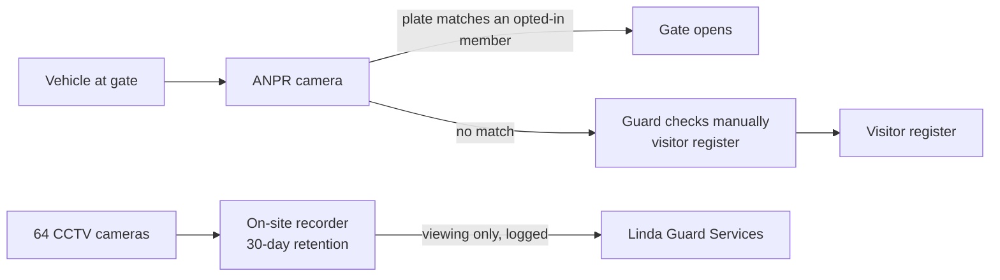
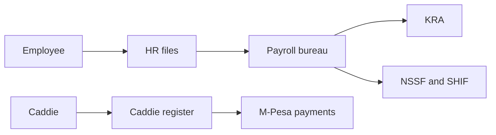

# Data-Flow Map

> **Portfolio project.** This is an independent learning project using a fictional organisation and illustrative data. It is not an audit, legal opinion, or certification.

How personal data moves between people, the Club's systems and its processors. Activity IDs refer to the [personal data inventory](personal-data-inventory.csv).

## Members and bookings (PA-01 to PA-05)

## Gate and site security (PA-06 to PA-08)

## Staff (PA-09 to PA-12)

## Transfers outside Kenya

| Flow | Destination | Safeguard | Assessment |
|---|---|---|---|
| Member records to FairwayOne | South Africa | Data processing agreement with transfer clauses, signed 10 December 2026 | [cross-border-transfer-assessment.md](../05-processors/cross-border-transfer-assessment.md) |
| Chatbot prompts to ModelCo | Outside Kenya | Sauti AI Labs agreement covering ModelCo; no account data sent to ModelCo | Same document |
