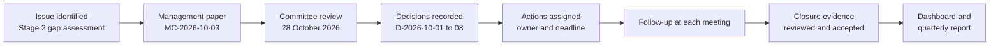

# Board Oversight Workflow

> **Portfolio project.** This is an independent learning project using a fictional organisation and illustrative data. It is not an audit, legal opinion, or certification.

How an issue moves from discovery to closure. The Stage 2 compliance results are the worked example in this folder.

| Step | Record |
|---|---|
| Issue identified | [Compliance management report](../../compliance-management-system/07-reporting/management-report.md) |
| Management paper | [board-paper.md](board-paper.md) |
| Committee review and decisions | [minutes.md](minutes.md) |
| Decisions recorded | [decision-register.csv](decision-register.csv) |
| Actions, follow-up and closure | [action-register.csv](action-register.csv) |
| Dashboard and report | [dashboard-data.csv](../08-reporting/dashboard-data.csv), [committee report](../08-reporting/committee-report.md) |
