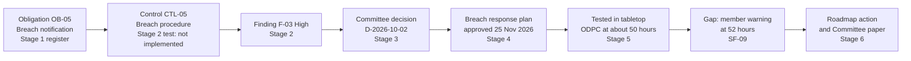

# Evidence Trail

> **Portfolio project.** This is an independent learning project using a fictional organisation and illustrative data. It is not an audit, legal opinion, or certification.

How one requirement moves through the five projects, using breach notification as the example.

## Where each type of evidence lives

| Evidence | Project | File |
|---|---|---|
| Obligations and their status | Compliance Management System | [compliance-register.csv](../../compliance-management-system/03-obligations-register/compliance-register.csv) |
| Control tests | Compliance Management System | [testing-workpapers.csv](../../compliance-management-system/04-gap-assessment/testing-workpapers.csv) |
| Committee decisions and actions | Enterprise Governance and Risk Dashboard | [decision-register.csv](../../enterprise-governance-risk-dashboard/06-board-oversight/decision-register.csv), [action-register.csv](../../enterprise-governance-risk-dashboard/06-board-oversight/action-register.csv) |
| Risks against appetite | Enterprise Governance and Risk Dashboard | [enterprise-risk-register.csv](../../enterprise-governance-risk-dashboard/05-risk-governance/enterprise-risk-register.csv) |
| Data protection assessments | Data Protection and Privacy Assurance | [04-dpia](../../data-protection-privacy-assurance/04-dpia/dpia-procedure.md) |
| AI testing | AI Governance Framework | [test-results.csv](../../ai-governance-framework/05-impact-assessment/test-results.csv) |
| Access and incident tests | Security Risk and Incident Management | [access-review.csv](../../security-risk-incident-management/04-access-review/access-review.csv), [incident-chronology.csv](../../security-risk-incident-management/06-tabletop-exercise/incident-chronology.csv) |
| Cross-project tracing | This project | [requirements-to-controls-mapping.csv](../04-requirements-mapping/requirements-to-controls-mapping.csv) |
