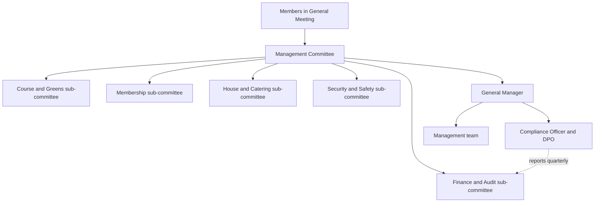

> **Portfolio project.** This is an independent learning project using a fictional organisation and illustrative data. It is not an audit, legal opinion, or certification.

Draft 0.1, prepared for review by Abel Holla.

## Principles

1. **Purpose first.** Decisions serve the Club's purpose: a well-run, financially sound club for its members, staff and community.
2. **Clear authority.** Every significant decision has one decision-maker, set out in the delegation of authority.
3. **Oversight with evidence.** The Management Committee decides on the basis of written papers and tracks every decision to closure.
4. **Risk within appetite.** Risks are compared with the approved risk appetite and escalated when they exceed it.
5. **Openness to members.** Members are told about major changes and can raise concerns.
6. **Integrity.** Conflicts of interest are declared and managed.

## Structure

The Compliance Officer reports to the General Manager day to day and directly to the Finance and Audit sub-committee each quarter, so that compliance concerns can reach the Committee without being filtered.

## Matters reserved to the Management Committee

- Club strategy, annual budget and annual accounts (for members' approval).
- The risk appetite statement.
- Any new use of personal data or technology rated high-risk, including AI and surveillance systems.
- Contracts above KES 5,000,000 or longer than three years.
- Appointment and removal of the General Manager.
- Club policies on compliance, data protection, anti-bribery, safety and conduct.
- Any matter where a General Manager decision would breach the risk appetite.

Lower-value and routine matters are delegated as set out in [delegation-of-authority.csv](https://github.com/HollaAB/ai-governance-portfolio/blob/main/enterprise-governance-risk-dashboard/03-governance-framework/delegation-of-authority.csv).

## Meetings and papers

- The Management Committee meets monthly. Papers are circulated five working days ahead, using the board paper format in [06-board-oversight](https://github.com/HollaAB/ai-governance-portfolio/tree/main/enterprise-governance-risk-dashboard/06-board-oversight).
- Each decision is given an ID in the decision register; each action it creates goes to the action register with an owner and deadline.
- Open actions are reviewed at every meeting until closed with evidence.

## Conflicts of interest

Committee members and senior staff declare interests on appointment, every year, and at the start of any meeting where a conflict arises, using the [declaration form](https://github.com/HollaAB/ai-governance-portfolio/blob/main/enterprise-governance-risk-dashboard/03-governance-framework/conflict-of-interest-declaration.md). A conflicted member leaves the discussion and does not vote.

## Review

This framework is reviewed every two years, or after a significant governance failure.
