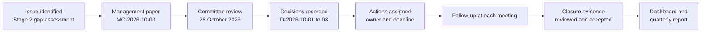

> **Portfolio project.** This is an independent learning project using a fictional organisation and illustrative data. It is not an audit, legal opinion, or certification.

How an issue moves from discovery to closure. The Stage 2 compliance results are the worked example in this folder.

| Step | Record |
|---|---|
| Issue identified | [Compliance management report](https://github.com/HollaAB/ai-governance-portfolio/blob/main/compliance-management-system/07-reporting/management-report.md) |
| Management paper | [board-paper.md](https://github.com/HollaAB/ai-governance-portfolio/blob/main/enterprise-governance-risk-dashboard/06-board-oversight/board-paper.md) |
| Committee review and decisions | [minutes.md](https://github.com/HollaAB/ai-governance-portfolio/blob/main/enterprise-governance-risk-dashboard/06-board-oversight/minutes.md) |
| Decisions recorded | [decision-register.csv](https://github.com/HollaAB/ai-governance-portfolio/blob/main/enterprise-governance-risk-dashboard/06-board-oversight/decision-register.csv) |
| Actions, follow-up and closure | [action-register.csv](https://github.com/HollaAB/ai-governance-portfolio/blob/main/enterprise-governance-risk-dashboard/06-board-oversight/action-register.csv) |
| Dashboard and report | [dashboard-data.csv](https://github.com/HollaAB/ai-governance-portfolio/blob/main/enterprise-governance-risk-dashboard/08-reporting/dashboard-data.csv), [committee report](https://github.com/HollaAB/ai-governance-portfolio/blob/main/enterprise-governance-risk-dashboard/08-reporting/committee-report.md) |

# Management Committee Paper MC-2026-10-03

All results, dates and decisions are scenario results for the fictional Club.

**Title:** Compliance gap assessment results and governance improvements
**Meeting:** Management Committee, 28 October 2026
**Presented by:** General Manager, with the Compliance Officer (DPO)
**Decision required:** Yes

## 1. Purpose

To report the results of the first compliance gap assessment and to ask the Committee to approve a compliance policy, a corrective-action plan, a risk appetite statement and a delegation of authority.

## 2. Background

The Committee asked for a compliance management system in July 2026. The Club now has a register of 36 applicable obligations. A gap assessment in October tested all 22 controls.

## 3. Key results

- 18 obligations compliant, 14 partly compliant, 4 not compliant.
- 16 findings: 4 High, 9 Medium, 3 Low.
- High findings: no DPIA for the ANPR pilot or Kijani Assist; processor contracts without data protection terms; no breach procedure; no fire drill in 14 months.
- The ANPR pilot and Kijani Assist were approved by management without Committee review. There is no delegation of authority that says they should have come to the Committee.

## 4. Options

| Option | Effect |
|---|---|
| A. Note the report only | Findings remain open; regulatory and safety risk continues |
| B. Approve the corrective-action plan only | Fixes the specific gaps, but the approval gap that caused F-01 remains |
| C. Approve the plan and the governance changes (recommended) | Fixes the gaps and stops new high-risk projects starting without oversight |

## 5. Recommendation

Option C. The Committee is asked to:

1. Approve the compliance policy.
2. Approve the corrective-action plan and its deadlines.
3. Pause further ANPR expansion until its DPIA is complete.
4. Adopt the risk appetite statement.
5. Adopt the delegation of authority, including the reservation of high-risk technology and data decisions to the Committee.
6. Approve the refreshed terms of reference of the Finance and Audit and the Security and Safety sub-committees.
7. Require annual conflict of interest declarations from all Committee members and senior staff.
8. Seek a legal opinion on the engagement of caddies.

## 6. Risk and resource implications

- Legal opinion on caddies: about KES 250,000 (scenario estimate).
- DPIAs and contract updates: within existing staff time, with Stage 4 support.
- No change to the approved budget.

## Attachments

[Compliance management report](https://github.com/HollaAB/ai-governance-portfolio/blob/main/compliance-management-system/07-reporting/management-report.md); [risk appetite statement](https://github.com/HollaAB/ai-governance-portfolio/blob/main/enterprise-governance-risk-dashboard/05-risk-governance/risk-appetite-statement.md); [delegation of authority](https://github.com/HollaAB/ai-governance-portfolio/blob/main/enterprise-governance-risk-dashboard/03-governance-framework/delegation-of-authority.csv); [terms of reference](https://github.com/HollaAB/ai-governance-portfolio/blob/main/enterprise-governance-risk-dashboard/03-governance-framework/committee-terms-of-reference.md).
