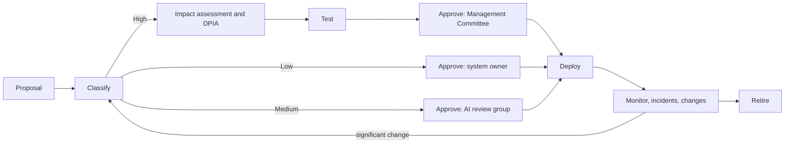

> **Portfolio project.** This is an independent learning project using a fictional organisation and illustrative data. It is not an audit, legal opinion, or certification.

Draft 0.1, prepared for review by Abel Holla.

**Approved by:** Management Committee, 9 December 2026 (scenario) | **Owner:** General Manager

## Purpose

To make sure the Club uses AI safely, lawfully and for members' benefit, with people in control.

## Roles

| Role | Responsibility |
|---|---|
| Management Committee | Approves high-risk AI systems and this charter |
| AI review group (General Manager, Compliance Officer (DPO), ICT Officer, Membership and Events Manager) | Classifies, assesses and tests AI systems; approves medium-risk systems; meets monthly |
| System owner | Runs the system day to day, monitors it, reports incidents |
| Human reviewer | Reviews, corrects or overrides AI outputs as set in the oversight matrix |
| All staff | Follow the [acceptable-use policy](https://github.com/HollaAB/ai-governance-portfolio/blob/main/ai-governance-framework/06-oversight/ai-acceptable-use-policy.md) |

## Lifecycle

## Rules

- No AI system is used unless it is in the inventory.
- High-risk systems need an impact assessment, a DPIA, passing test results and Committee approval before use.
- Every system has a human who can override it; no decision with a significant effect on a person is left to AI alone.
- Members are told when they are dealing with AI.
- Significant changes (new model, new data, new purpose) go back through classification and testing.
