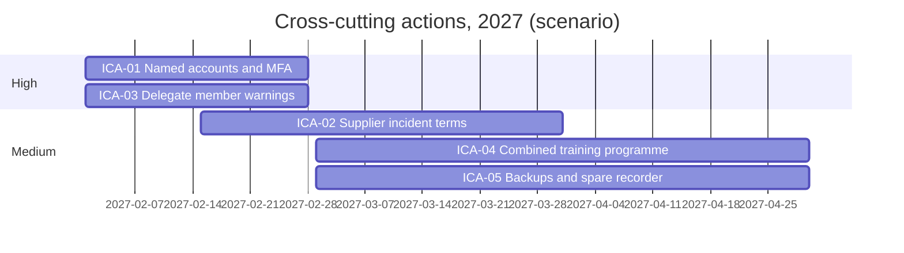

> **Portfolio project.** This is an independent learning project using a fictional organisation and illustrative data. It is not an audit, legal opinion, or certification.

All results, dates and decisions are scenario results for the fictional Club.

All 28 open corrective actions from the five projects, in one plan. Details: [remediation-roadmap.csv](https://github.com/HollaAB/ai-governance-portfolio/blob/main/integrated-grc-capstone/05-findings-and-remediation/remediation-roadmap.csv). Cross-cutting actions: [corrective-action-tracker.csv](https://github.com/HollaAB/ai-governance-portfolio/blob/main/integrated-grc-capstone/05-findings-and-remediation/corrective-action-tracker.csv).

## By phase

| Phase | Open actions |
|---|---|
| Phase 1: by March 2027 | 21 |
| Phase 2: April to June 2027 | 7 |

## By project

| Project | Open actions |
|---|---|
| AI Governance Framework | 3 |
| Compliance Management System | 9 |
| Data Protection and Privacy Assurance | 4 |
| Enterprise Governance and Risk Dashboard | 4 |
| Security Risk and Incident Management | 8 |

## Timeline of the cross-cutting actions

## Tracking

The Compliance Officer reports progress against this roadmap to the Finance and Audit sub-committee each quarter, and the Management Committee reviews it through the [portfolio dashboard](https://github.com/HollaAB/ai-governance-portfolio/blob/main/integrated-grc-capstone/06-dashboard/portfolio-dashboard.csv).
