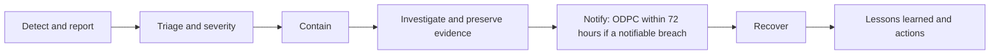

# Security Incident Response Plan

> **Portfolio project.** This is an independent learning project using a fictional organisation and illustrative data. It is not an audit, legal opinion, or certification.

Draft 0.1, prepared for review by Abel Holla.

**Owner:** ICT Officer, with the Compliance Officer (DPO) for personal data | **Approved by:** Security and Safety sub-committee (pending)

## Incident team

| Role | Who | Responsibility |
|---|---|---|
| Incident lead | ICT Officer (deputy: General Manager) | Runs the response, keeps the chronology |
| Data protection | Compliance Officer (DPO) | Breach assessment, ODPC notification, people affected |
| Decision-maker | General Manager | Approves shutdowns, payments to suppliers, public messages |
| Physical security | Head of Security | Site incidents, CCTV evidence |
| Communications | Membership and Events Manager | Messages to members and staff |
| Suppliers | FairwayOne, Sauti AI Labs, ICT support firm | Investigation on their systems |

## Phases

1. **Detect and report.** Anyone who sees something suspicious reports it to the ICT Officer at once (phone, then email). Members' reports to reception are passed on immediately.
2. **Triage.** The incident lead sets the severity using the [severity matrix](severity-matrix.csv) and opens the [chronology](../06-tabletop-exercise/incident-chronology.csv) template.
3. **Contain.** Disable accounts, reset passwords, isolate devices, ask suppliers to block access.
4. **Investigate.** Preserve logs and footage with the [chain-of-custody form](chain-of-custody-form.md); find the cause and scope.
5. **Notify.** For personal data, follow the [breach response plan](../../data-protection-privacy-assurance/08-breach-response/breach-response-plan.md). Warn members within 24 hours if there is a risk of fraud.
6. **Recover.** Restore services under the [continuity and recovery plan](../07-continuity/continuity-and-recovery-plan.md).
7. **Learn.** Within 10 working days, review what happened and record actions in the [corrective-action tracker](../08-findings-and-actions/corrective-action-tracker.csv).

## Contacts

The incident contact list (names, phones, supplier out-of-hours lines) is kept in a sealed envelope at reception and in the General Manager's phone. It is not published.

## Playbooks

[incident-playbooks.md](incident-playbooks.md): account compromise and phishing; supplier data breach; physical security incident.
